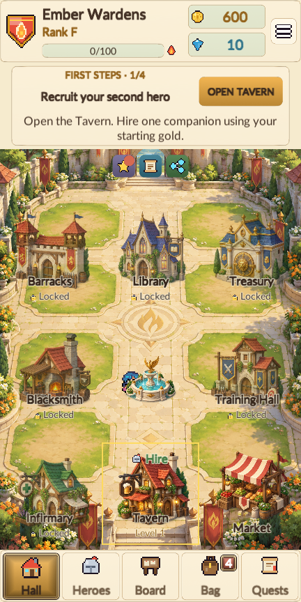

# Emberhall: Guild Legends

A portrait 2D **guild manager** for Android, built in Unity 6 (6000.6.1f1) on top of the reusable
**Manager Simulator Template** (`ManagerKit`). Version 1.4.0 combines bright painted fantasy illustrations with animated
pixel characters, cream and sage panels, and sky-blue accents. Large illustrations use hooded or helmeted heroes and
views from behind; front-facing pixel characters remain part of gameplay. Music and sound effects remain procedural.

## Core loop

Recruit heroes → form a party → pick a quest → auto-battle → earn loot & gold → upgrade heroes, gear and facilities → unlock harder content (Rank F → S).

## Features

- Thirteen generated art assets: splash, phoenix branding, four story illustrations, three atlases with 18 painted item icons, a Hall courtyard/building atlas, and two battle arenas
- Five-page onboarding: three animated story scenes, a practical guild guide, then guild name, banner and starter selection
- Authored English and Bahasa Indonesia story narration shown as paced text, with manual/auto controls and story replay
- Larger Lato typography, contained centered labels, scrollable story and party strips, and spacious hero/stat lists
- Guild Hall with living buildings: **Tavern, Blacksmith, Training Hall, Infirmary, Barracks, Treasury, Library**
- 6 classes + 7 tameable **monster recruits**, traits, rarities, promotions, party **synergies**
- Auto-battle (ATB sim with skills, statuses, bosses), encounter-aware Auto party selection, three battle doctrines, animated replay, x1/x2/x3 speed, pause/resume, and skip
- Campaign (5 regions, 25 stages, 3 stars), **timed Contracts/expeditions**, **Endless Spire**, **Rank exams** F→S
- Gear with 5 rarities, affixes, enhancement, crafting, salvage; daily Market; Soul Seals; consumables
- The Lantern Road: 25 connected story chapters, a spoiler-free Journal, 33 side quests, daily quests, a login calendar, and guild events
- Offline progress: absolute-time timers, idle Treasury vault, expedition returns, "Welcome back" report
- Atomic save with backup, autosave, EN + Bahasa Indonesia, settings, about, share, rate, onboarding, tutorial pointer
- Google AdMob test integration: adaptive banner, limited battle-break interstitials, optional rewarded gold/supplies, UMP privacy choices
- Renewable stamina, free opening trails, daily camp supplies, regional boss mastery and connected region progression

## Version 1.4.0 — A clearer journey

The title menu sits directly over the bright illustration. Hero rows use larger, dark names and clear level labels.
Hall residents walk around the fountain. Battle removes floating names and duplicate roster labels, enlarges the
characters and gives the arena more room. Auto team selects a party; **Start auto battle** runs that encounter to its
result. Playback timing and multi-wave completion are repaired, with pause, speed and skip retained.

Campaign trails use 2 stamina; bosses and Spire floors use 3. The reserve holds 30, recovers one every five minutes
including offline, and offers a free daily camp ration of 10. The first three trail clears are free and a defeat or
interrupted encounter costs at most one. Eight trail stars open a regional boss; its clear and the guild rank open
the next region. Training, crafting, contracts and guild exams remain available without stamina.
See [gameplay design](Store/Gameplay-design.md) for the rules and progression loop.

[Download the signed APK](Releases/README.md) — Android version code **8**.
See [validation evidence](Store/Validation/1.4.0/README.md) and [AdMob setup](Store/AdMob-setup.md).
Google sample ad IDs remain enabled; they earn no revenue. Native ad serving still requires a compatible phone.

## Version 1.3.0 — Optional video bonuses

The official Google Mobile Ads Unity SDK is integrated with Google sample IDs. Adaptive banners have their own
space below navigation. Interstitials are limited to returns from campaign victories, with warm-up, frequency and
session limits. Rewarded videos offer optional victory gold or guild supplies; only an earned callback grants the
bonus, and duplicate callbacks cannot double it. The first four tutorial chapters remain free of automatic ads.

[Download the 1.3.0 APK](Releases/1.3.0.md) — Android version code **7**.
See [AdMob setup](Store/AdMob-setup.md), [privacy policy](Store/Privacy-policy.md) and
[validation evidence](Store/Validation/1.3.0/README.md). This release uses test ads and earns no ad revenue.

## Version 1.2.1 — Open Hall labels

The Hall now displays building names and Market directly over the art. White name plaques, action boxes and construction
timer boxes are removed. Locks, levels and action icons remain, with a fine ivory text edge and full transparent tap
areas. Hire/Heal/Build/Upgrade and Treasury collection stay interactive.

[Download the 1.2.1 APK](Releases/1.2.1.md) — Android version code **6**. The final portrait tour passed **312 flow checks**
and checked **3166 visible texts across 89 screenshots** with no layout issues.
See [validation evidence](Store/Validation/1.2.1/README.md).



## Version 1.2.0 — The Lantern Road

The interface now uses Lato with a 36-unit minimum and a 44-unit body size on the 1080-unit reference canvas.
Previously small labels, resource numbers, status badges and rich-text annotations are larger. Buttons use their
available height, and descriptions, portraits, reward cells and long names have dedicated room. The Hall retains
unframed building labels; hero cards and stat panels use wider rows, and larger parties scroll horizontally.

Thin ivory frames and simple rounded buttons keep the painted environments visible. The first-steps guide replaces
the duplicate Hall quest card, and routine upgrade badges no longer crowd every building. Prologue scenes use brief
story beats with more room for the illustration; the Journal holds the longer narrative. Facility banners now reuse
the painted buildings and courtyard rather than enlarging the old pixel backdrops.

The prologue and all 25 main chapters follow one journey: recover five beacon lenses, reopen the village roads,
and discover the Spire's purpose with Maren. Current quests give short, explicit instructions. The Journal preserves
completed and current chapters without exposing locked stories. A new bright frontier illustration appears in the
opening, Campaign/Spire banners and chapter rewards. This remains an illustrated cinematic with written narration.
The illustration's built-in generation mode and full prompt are documented in [Frontier art notes](Store/Frontier-art-notes.md).

Auto party selection compares available heroes in the real encounter simulator, including doctrine, health and
synergies; its deterministic previews preserve the campaign's random sequence. Contracts consider departure success.
Battle now supports Pause/Resume, retains the chosen speed while paused, and can Skip from a paused state. Battle
characters are larger, and their animation follows playback speed and pause. English remains the installation default.

Android version code: **5**. The 1.2.0 APK is documented in [its release notes](Releases/1.2.0.md).

Validation: **71 core tests passed**, no failures; the final narrow-screen run passed **312 interface flow checks**
and checked **3182 visible texts across 89 screenshots** with no reported overflow or containment issues.
The full evidence and device-test limits are in [Validation](Store/Validation/1.2.0/README.md).

 


## Version 1.1.2 English default and functionality

New installations start in English. Existing installations move to the English default once on upgrade; choosing
English or Bahasa Indonesia manually afterward remains saved. Blank or unsupported language settings fall back to
English. Screenshot tours keep their language, audio and other preferences separate from the player's settings.

Gear sale and salvage reject items that have already left the bag, and enhancement cannot charge for a removed item.
Market purchases reject sold or expired offers. Guild events resolve only while pending, reject invalid choices, and
leave unaffordable choices pending. Daily quests now honor their declared facility prerequisites when selected.
Hero dismissal preserves the last guild member and rejects heroes committed to training, healing or an unclaimed
expedition. Successful dismissal returns equipped gear to the bag. Hero promotion rejects missing, foreign or busy
heroes before charging resources.

Closing a nested hero/item picker or promotion refreshes the remaining details and visible page. Lists keep their
scroll position within the available content after a change. Contract returns, refreshed Board/Tavern/Market offers
and free Tavern refresh controls update as their state changes. Party readiness and combat previews track health and
stat changes, and the hardware Back action respects the battle screen's handler. Event dialogs show their usable
choice/Continue flow without an inactive close button.

The functional test suite covers payments, facility/research deadlines and slots, gem speedups, training/healing,
crafting quantities, enhancement caps, inventory disposal, daily Market purchases, login rewards, eligible daily
quests, guild events, rank exams/promotions, tower progression and expedition save/offline payouts. Every guild event
has a free fallback choice, so its mandatory choice flow can always proceed.

This earlier release was **1.1.2**, with Android version code **4**. EditMode, comprehensive interface checks at two
portrait resolutions, and final Windows/Android builds have passed. Earlier release validation is retained below.

## Version 1.1.1 Hall, battle and label refinement

The bright painted style now extends to the Guild Hall through two new assets in `Assets/Resources/Art/Generated`:
`hall_ground.png`, a 1024 × 1536 courtyard, and `hall_buildings.png`, a 1254 × 1254 atlas with transparent backgrounds.
Its 3 × 3 arrangement uses nine nominal 418 × 418 cells: Tavern, Blacksmith, Training Hall, Infirmary, Barracks, Treasury,
Library, Market and Fountain. The runtime infirmary/library cut follows a transparent gap at source row 810 to preserve
the full library spire. Painted Hall art uses smooth sampling; animated characters retain their original sprite style.
The art prompts and slicing details are recorded in `Store/Hall-art-notes.md`.

The Hall uses larger centered names and status labels on slimmer plaques, with a clearer quest tracker. Decorative
diamonds sit at panel corners, interface labels are larger and centered, and popup heights adapt to their content and
the available viewport.

Two new 1024 × 1536 painted arenas, `battle_meadow.png` and `battle_ruins.png`, give battles a bright open floor.
Sunmeadow and Whisperwood use the meadow; other regions, the Spire and exams use the stone courtyard. The 112-pixel
mission header and 292-pixel bottom strip leave more room for the arena. The horizontal hero roster retains readable
32-pixel names and 28-pixel class/level labels and HP; larger parties can scroll sideways. Small cream name chips follow the name's
width and distinguish heroes and enemies with green/red accents. Names, HP bars and projectile aim follow the visible
sprite bounds, keeping them attached despite transparent frame padding. Animated characters retain visible front/side faces.
Background prompts are saved in `Store/Battle-art-notes.md`.

This refinement shipped as **1.1.1**, with Android version code **3**. Its Windows/Android builds and both screenshot
tours completed; their historical validation is retained below.

## Version 1.1.0 polish

The opening follows Emberhall's renewal after a storm, Maren's welcoming hearth, and the road to the shining Spire.
Scene art gently moves while the narration appears. This is an illustrated, text-narrated cinematic; it does not include
recorded voiceover or a prerendered video. The title screen can replay the three scenes without resetting a guild.
The selected starter arrives with the same portrait shown on the charter, fully healthy and equipped, with 600 starting
gold and five healing potions. Maren's guide gives explicit destinations and usable actions for hiring, Campaign battles,
claiming chapter rewards and equipping gear. It occupies a dedicated strip below the HUD; actions performed early still count.

New art lives in `Assets/Resources/Art/Generated`: `splash.png`, `story_fall.png`, `story_oath.png`, `story_dawn.png`,
`guild_icon.png`, and three inventory atlases: `item_relics.png`, `item_arms.png`, and `item_misc.png`. Their 18 cells cover
sword, plate armor, ring, potion, ore, book, bow, spear, staff, dagger, phoenix crest, boots, light armor, robe, amulet,
essence, Soul Seal and coin bag. `GeneratedArt` loads and slices these assets;
`Art.ItemIcon` chooses them by item family. The editor's **Generate App Icon** action exports the painted phoenix to
the application icon and `Store/icon_512.png`.

Party selection includes three plans. Its estimated win chance uses the same plan as the battle itself:

| Plan | Tradeoff | Target priority |
|---|---|---|
| Balanced | Full attack and defense | Wounded enemies |
| Assault | +18% ATK, +8% SPD, -20% DEF | Lowest remaining HP |
| Guard | +35% DEF, 8% starting shield, -8% ATK | Strongest ATK × SPD threat; earlier healing |

Healers prioritize endangered allies, control skills spread their effects, and front-line heroes draw more enemy attacks.
Shield casts apply once; buffs, poison and stun now last their specified turns. Facility and research bonuses immediately
invalidate cached hero statistics. Auto-equip evaluates gear for the hero's role.

The first mission grants 30 XP, 60 extra gold and two potions on its first clear. Special skills unlock at level 2,
clerics can heal from level 1, and the infirmary becomes available after two wins. Surviving heroes recover 10% maximum
HP after victory; fallen heroes return with 20%. Level-ups restore 8% HP per gained level, and passive regeneration is
3% maximum HP per minute. Recruiting initially offers Knight, Cleric and Warrior candidates, correctly rotates expired
candidates, and guarantees a rare-or-better candidate every 12 generated candidates.

Contract boards offer safe, standard and demanding routes drawn from unlocked templates. Hero health, distinct
recommended classes and party synergies affect the forecast. The chance is saved at departure, so the return resolves
against the displayed forecast. Duplicate party members, repeat hires, and premature or repeated expedition payouts
are rejected. Healthy heroes cannot waste potions, and equipped gear cannot be sold through stack-selling.
Readiness errors explain whether a hero needs recovery or is committed to a task, and point to the relevant screen.

Existing save version 1 remains supported. Added expedition forecasts default to the previous calculation when absent
from an older save. See `CHANGELOG-polish.md` for validation status and controls.

## Using it as a template (Blacksmith / Pirate / Kingdom / Monster Manager …)

`Assets/ManagerKit/Core` contains reusable systems: wallet, counters, modifiers, roster/units, inventory/loot/crafting,
timers, upgrades (facilities + research), stations (train/heal), missions (battle + expeditions + endless), quests, ranks,
random events, idle vault, market, daily, save/offline, battle simulator. Everything is driven by JSON content packs:

| File (`Assets/Resources/Content/emberhall/`) | Defines |
|---|---|
| `core.json` | balance numbers, currencies, stats, rarities, traits, skills, classes, monster units, synergies, ranks, login calendar |
| `items.json` | items, recipes, loot tables (generated by `Tools/gen_items.ps1`) |
| `world.json` | enemies, regions, missions, exams, contract templates (`Tools/gen_world.ps1`) |
| `guild.json` | facilities, research, stations |
| `quests.json` | main / side / daily quests, random events (`Tools/gen_quests.ps1`) |

To make a new game: copy the content folder, edit the JSON, point `GuildGame.ContentFolder` at it and replace the screens in
`Assets/Emberhall/UI`. `Assets/ManagerKit/UI` is a code-first UGUI kit with painted frames, tweens, popups, toasts,
procedural fallback icons, chiptune audio, and localisation.

## Tooling

```
Tools\unity.ps1 -Tests EditMode              # content, saves, combat, payments, timers, stations, crafting and language tests
Tools\unity.ps1 -Method Emberhall.EditorTools.BuildTools.BuildApk   -Extra '-buildTarget','Android'
Tools\unity.ps1 -Method Emberhall.EditorTools.BuildTools.BuildAab   -Extra '-buildTarget','Android'
Tools\unity.ps1 -Method Emberhall.EditorTools.BuildTools.BuildWindows
Builds\Win\Emberhall.exe -gm-tour -screen-width 540 -screen-height 960
Builds\Win\Emberhall.exe -gm-tour-id -screen-width 432 -screen-height 864
Builds\Win\Emberhall.exe -gm-verify -screen-width 540 -screen-height 960
Tools\import_assets.ps1                      # copy sprites from the asset library
```
Menu: **Emberhall → Configure Project / Generate App Icon / Build … / Validate Content**.

Tours use a separate save slot and preference keys, and create timestamped screenshot directories under `shots`. `-gm-tour` captures the
English flow plus key Indonesian screens; `-gm-tour-id` captures the Indonesian flow. Use `-gm-tour-dir <directory>`
to choose another destination. Each screenshot has a text-containment audit, with an aggregate `layout-audit.json`.
Existing screenshot runs are preserved. `-gm-verify` extends the opening with functional checks through actual game
controls. Later-feature checks use staged resources and unlocked rank state after the original starting-resources
opening has passed.

## Verified version 1.1.2

The final 1.1.2 EditMode run completed with **69 passed, 0 failed, and one explicitly skipped long-running pacing
simulation** (**70 cases total**; `Logs/verify_tests_final.log`, `Logs/results_EditMode.xml`). This includes all **59 CoreTests**,
all **9 language cases**, and the **FirstSessionPacing** simulation. `FullPlaythroughPacing` remains explicit and was not
run. The core suite adds 28 cases covering transaction, timer, payout and save/offline invariants, including six
dismissal/promotion regressions.

Both comprehensive functional tours passed, each following the English flow plus selected Indonesian screens:

| Resolution | Screenshots | Texts checked | Passing flow checks | Layout issues | Failed flow checks |
|---|---|---|---|---|---|
| 540 × 960 | 80 | 2,890 | 289 | 0 | 0 |
| 432 × 864 | 80 | 3,065 | 289 | 0 | 0 |
| Combined | 160 | 5,955 | 578 | 0 | 0 |

Each run has **68 English and 12 Indonesian captures**. These are English functional tours with key Indonesian
coverage; the narrow run is not a full Indonesian tour. Reports are `Builds/Win/verify-final-en/layout-audit.json`
and `Builds/Win/verify-final-narrow/layout-audit.json`. The checks exercise settings and language, facility construction and
upgrades, research, forging, training/healing, inventory/equipment, Market purchases, contract refresh/send/return,
daily/event rewards, hero promotion/dismissal, battle/result controls and save/exit/Continue persistence.

The final Windows build succeeded and includes the latest Indonesian strings (`Logs/verify_windows_final.log`).
The final Android build succeeded (`Logs/verify_android_final.log`): `Builds/Emberhall-1.1.2.apk`, **64,671,355 bytes**.
APK inspection confirms `com.pixelgamemaster.emberhall`, version **1.1.2**, version code **4**, ARM64, minimum API **26**
and target API **36**. APK signature verification passed with v2 signing.

No Android device was connected for an installation/device test. Native Share/Rate integrations have been reviewed
in code and their UI controls checked; external platform dialogs have not been invoked.

## Verified version 1.1.1

Windows and Android builds succeeded (`Logs/final_polish_windows.log`, `Logs/final_polish_android.log`). The APK is
`Builds/Emberhall-1.1.1.apk` (**64,605,319 bytes**). APK inspection confirms `com.pixelgamemaster.emberhall`, version
**1.1.1**, version code **3**, ARM64, minimum API **26** and target API **36**.

The English Windows tour at **540 × 960**, including key Indonesian screens, completed with **59 captures and 2,127
checked text elements**. The full Indonesian tour at **432 × 864** completed with **48 captures and 1,886 checked text
elements**. Both reported **zero text-layout issues and zero opening-flow failures**: **107 captures and 4,013 checked
text elements** in total. Reports are `Builds/Win/final-polish-en/layout-audit.json` and
`Builds/Win/final-polish-id/layout-audit.json`; neither runtime log reported exceptions or failed flow checks.

Both tours verify creating a guild, paying for a recruit, winning the first battle, claiming chapters 1–3, auto-equipping
and unlocking chapter 4 through actual game controls before adding resources for later screenshots. This UI refinement
retains the earlier core test record below; the core suite was not rerun for this pass.

## Verified version 1.1.0

Unity EditMode validation completed with **32 passed, 0 failed, and one explicit long-running pacing simulation skipped**
(33 cases total, historical 1.1.0 record). The English Windows tour at **540 × 960**, including key Indonesian
screens, captured **59 screenshots and checked 2,127 text elements**. The full Indonesian tour at **432 × 864** captured
**48 screenshots and checked 1,880 text elements**. Both reported **zero text-layout issues and zero opening-flow
failures**: **107 captures and 4,007 checked text elements** in total. Reports are
`Builds/Win/polish-release-en/layout-audit.json` and `Builds/Win/polish-release-id/layout-audit.json`.

The tour creates an Archer guild, spends the original starting gold on a real recruit, claims chapter 1, wins the first
battle through the actual Fight button, claims chapter 2, uses the Bag's auto-equip action, claims chapter 3 and unlocks
chapter 4. This sequence runs before the tour adds resources for later-screen coverage.

Windows and Android builds succeeded (`Logs/polish_windows_release.log`, `Logs/polish_android_release.log`). The APK is
`Builds/Emberhall-1.1.0.apk` (49,960,195 bytes). Its package metadata confirms version **1.1.0**, version code **2**,
ARM64, minimum API **26**, and target API **36**. See `CHANGELOG-polish.md` for the detailed validation record.

## Release notes

- Package: `com.pixelgamemaster.emberhall`, minimum Android 8.0 (API 26), target API 36, ARM64, IL2CPP.
- Release signing key: `Keystore/emberhall.keystore` (password in `Keystore/PASSWORDS.txt`). **Back it up and never commit it.**
- Store icon: `Store/icon_512.png`. The game includes AdMob test ads, with no IAP. Publish the privacy policy and
  complete advertising/data disclosures for the final SDK configuration before a store release; see
  [AdMob setup](Store/AdMob-setup.md).
