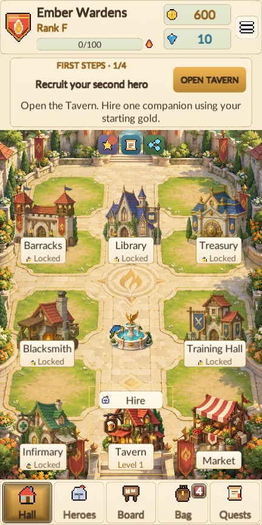
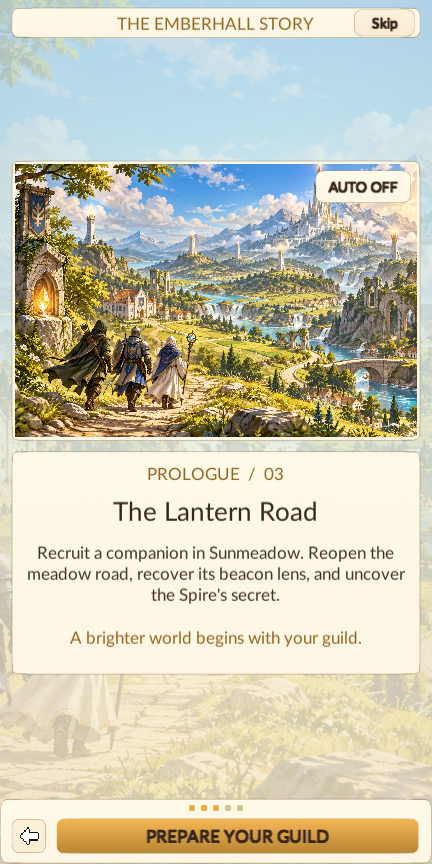

# Version 1.2.0 verification — 12 October 2026

| Check | Result |
| --- | --- |
| EditMode core tests | 71 passed, 0 failed, 1 explicit long pacing simulation skipped |
| Standard portrait tour, 540 × 960 | 89 screenshots, 2990 visible text checks, 0 layout issues, 312 flow checks passed |
| Final narrow portrait tour, 432 × 864 | 89 screenshots, 3182 visible text checks, 0 layout issues, 312 flow checks passed |
| Windows and Android release builds | Succeeded, no build errors |
| Android package | 1.2.0, version code 5, ARM64, min API 26, target API 36 |

The final narrow tour includes the warm ivory background and the adjusted Research cost-row height. The standard tour
preceded those two final presentation adjustments. Both tours cover English and key Indonesian screens. Reports retain
the actual checked controls, rendered font sizes and text bounds; fully clipped scroll content is excluded.

The first gameplay loop uses a fresh charter, the original starting resources, a paid Tavern hire, the real first fight,
earned quest rewards and Auto equip. Later verification fixtures provide resources and eligible heroes to cover advanced
features. They do not replace that untouched first-loop check. The widest authored hero names are exercised explicitly.

The 312 flow checks cover settings/language, facilities and timers, training/healing/research, crafting, equipment and
inventory, Market purchases/sales, Contract departure/return/claim, daily rewards, event choices, live party readiness,
doctrines, battle speed/pause/resume/skip/retry/next, Endless Spire, rank exams and celebrations, dismissal safeguards,
and save/title/continue persistence. Test preferences and save data use an isolated verification slot.

No Android device was connected. Native Share/Rate controls were checked for presence; external platform actions,
physical-device installation, touch behavior, thermal performance and audio output were not exercised.

 

[Core test XML](core-tests.xml) · [Standard audit](standard-audit.json) · [Final narrow audit](narrow-audit.json)
