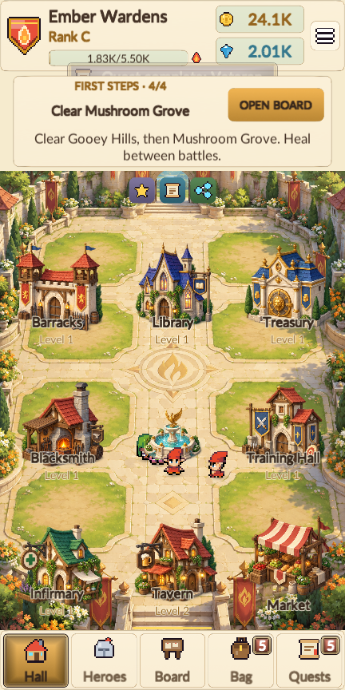

# Hall label verification — 1.2.1, 12 October 2026

- Windows and Android release builds succeeded with no build errors.
- Final 432 × 864 portrait tour: 89 screenshots, 3166 visible text checks,
  0 reported layout issues, and all 312 interface flow checks passed.
- Both English and key Indonesian screens were checked. Text fitting retains the 36-unit minimum.
- The complete existing tour exercises building navigation, hiring, facility construction and upgrades, healing,
  Treasury collection, equipment, contracts, battle controls, Spire, rank exams and save/continue.
- No core game rules changed. Verification uses an isolated save and preferences; later fixtures cover advanced features.
- The Android signature and manifest were checked. Physical Android and external native Share/Rate actions were not tested.

 

[Layout and flow report](layout-audit.json) · [Readable report](layout-audit.txt)
