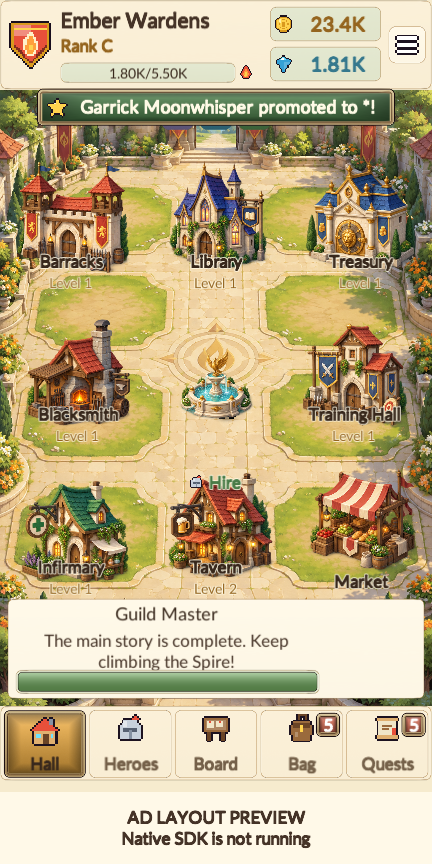
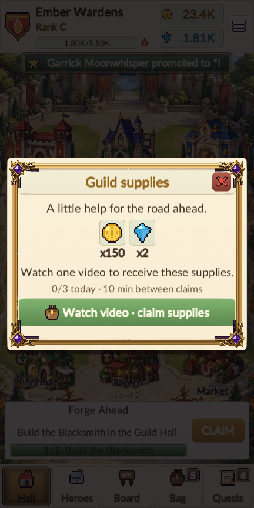
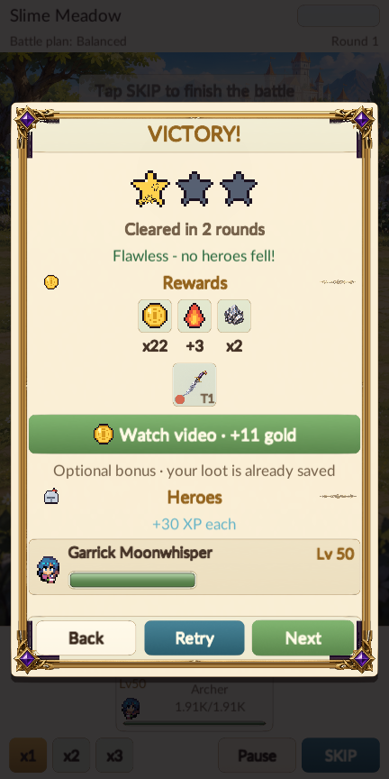

# AdMob verification — 1.3.0, 13 October 2026

- Windows and signed Android release builds succeeded with no build errors.
- EditMode: 82 cases, 81 passed, zero failed, one explicitly skipped long-running pacing simulation.
- Final 432 × 864 portrait tour: 96 screenshots, 3519 visible texts, zero layout issues, all 338 interface checks passed.
  English and key Indonesian screens were included, with the existing large-text fitting floor preserved.
- Ad coverage includes tutorial gating, banner reservation/modal/battle hiding, the real supplies and campaign-result
  controls, earned/duplicate/dismissed/failed callbacks, audio restoration, no-fill fallback and save/reload receipts.
- Unit cases cover actual reward amounts, concurrent tickets, daily cap/cooldown, midnight rollover, old-save
  compatibility, stale-guild/save callbacks and interstitial warm-up, spacing, inventory and session limits.
- The native APK contains the Google banner/interstitial/rewarded bridge classes, Mobile Ads and UMP classes,
  the sample Android app ID in the manifest, and all three Android test units in IL2CPP metadata. Its v2 signature,
  version 1.3.0/code 7, API 26/36 and ARM64 ABI were verified. See apk-check.json for the digest and exact results.
- The desktop ad client is a clearly labelled verification double, restricted to `-gm-verify`, with an isolated save
  and preferences. Its previews are not native ad impressions. No compatible Android device was connected. Actual
  serving, consent-region behavior, device safe areas, external ad clicks and native installation still require a phone.
- Native external Share/Rate actions and iOS builds are outside this verification.

The full existing game tour still exercises onboarding, hiring, construction, upgrades, healing, Treasury,
equipment, contracts, battle speed/pause/skip, Spire, rank exams, promotion, story and save/continue.

[Layout and flow report](layout-audit.json) · [Readable report](layout-audit.txt) ·
[Core tests](core-tests.xml) · [Native package inspection](apk-check.json)

Device check: install the APK on an ARM64 Android 8+ phone, finish the four opening tutorial chapters (or continue
an existing eligible guild), and return to Hall to check the adaptive banner. Settings → Ads & privacy provides
test interstitial/rewarded previews without bonuses. Use Guild supplies and a campaign victory to check actual
earned bonuses, early dismissal, airplane mode/retry and background/return. Automatic interstitials require the
documented warm-up and eligible wins; they must never appear on Retry, Next, defeat, exam or Spire results.
