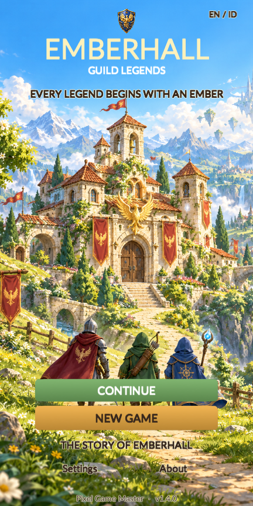
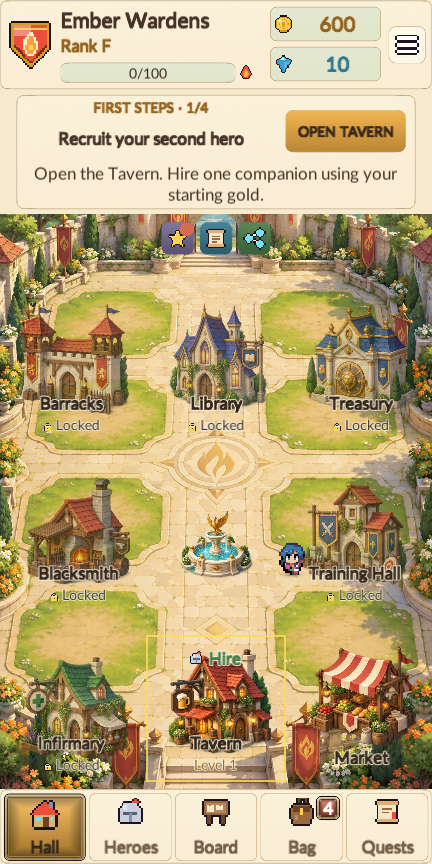
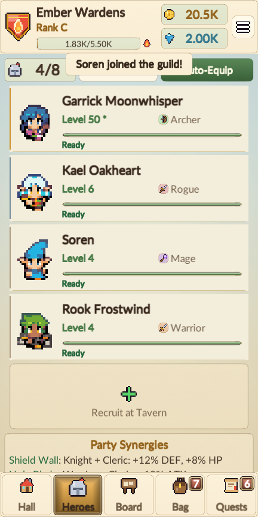
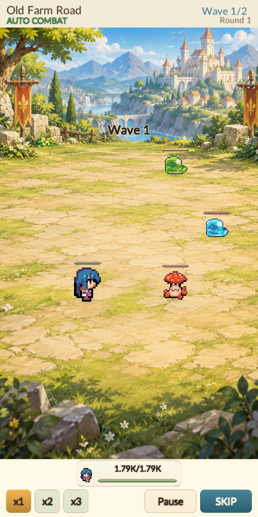
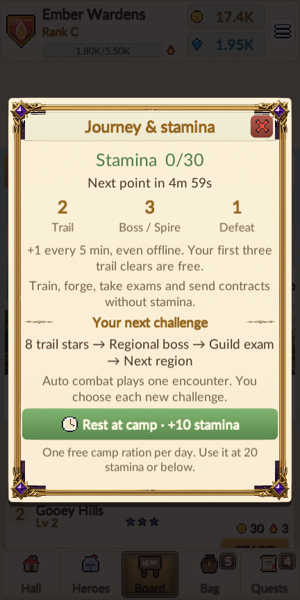
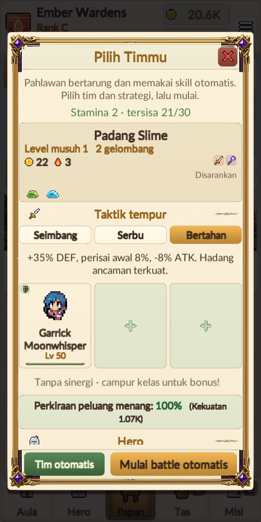

# Release verification — 1.4.0, 19 October 2026

- Windows and signed Android release builds succeeded with zero build errors.
- EditMode: 93 cases, 92 passed, zero failed, one explicitly skipped long pacing simulation.
- Final 432 × 864 desktop portrait tour: 100 screenshots, 3512 visible texts, zero layout issues and all 347 interface
  checks passed. English and key Indonesian screens were included; the longer Indonesian battle button fits.
- A real Start auto battle action ran a multi-wave encounter to victory without Skip. Stamina was deducted once
  and settled on completion. The playback log contains no animation exceptions or recovery fallback.
- The tour checks Auto team, speed, pause/resume, skip, empty-stamina gating, the real daily camp action, the Journey
  guide, save/continue, onboarding, hiring, facilities, equipment, contracts, story, Spire, exams and rank promotion.
- Added core cases cover free opening clears/replays, preview versus entry charges, duplicate settlement, defeat
  refunds, offline recovery/cap, exhaustion, free activities, daily camp persistence, interrupted/older saves,
  regional boss stars, previous-boss region gates and fountain path clearance.
- The Hall ring's adjacent segments remain outside the fountain basin. Screenshots also show sprite feet and the
  fountain's depth ordering. Hero names/levels use dark text on a quiet flat surface; battle has no unit name plaques.

## AdMob evidence and limits

Existing reward tests and the desktop tour check actual game buttons, earned/duplicate/dismissed/failed callbacks,
exact bonuses, receipts after reload, daily caps, cooldowns, audio restoration, banner insets/hiding and no-fill fallback.
Desktop ad previews are explicitly labelled flow/layout doubles; they are not native ads or impressions.

The final APK's Google banner/interstitial/rewarded bridge classes, Mobile Ads/UMP classes, sample manifest app ID
and three Android test unit IDs were inspected. Its v2 signature, version 1.4.0/code 8, API 26/36 and ARM64 ABI passed.
See [package inspection](apk-check.json) for its exact size, digest and signature results.

The final signed APK installed successfully on the owned Android 15/API 35 emulator with ARM64 translation. Launch
stopped at **Unable to initialize the Unity Engine Graphics API**, before game startup or ad requests. The emulator
failure is documented in [Android startup check](android-startup-check.json) and [the captured dialog](android-startup.png).
No physical phone was connected. Native banner serving, full-screen presentation/close, rewarded earned callbacks,
UMP regional forms and physical-device safe areas therefore remain unverified. Unity's
[Android system requirements](https://docs.unity3d.com/6000.0/Documentation/Manual/system-requirements.html)
do not support running the player inside an Android emulator.

The release includes an explicit isolated native QA mode using the real Google SDK. See
[AdMob setup](../../AdMob-setup.md#native-android-check) for the phone procedure. Native Share/Rate actions, iOS and
long-term campaign balance are outside these automated checks. No advertising revenue is generated by test IDs.

[Layout and flow report](layout-audit.json) · [Readable report](layout-audit.txt) · [Core tests](core-tests.xml)
· [Gameplay rules](../../Gameplay-design.md)
