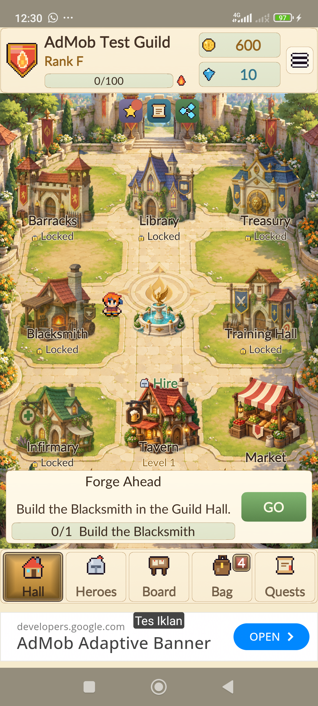
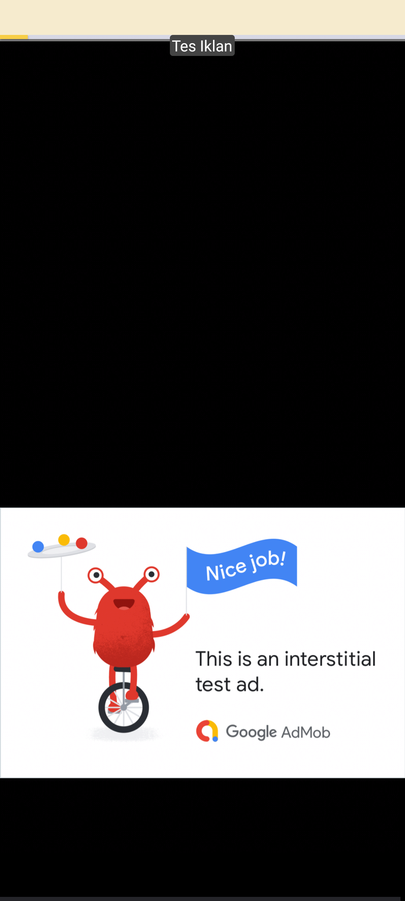
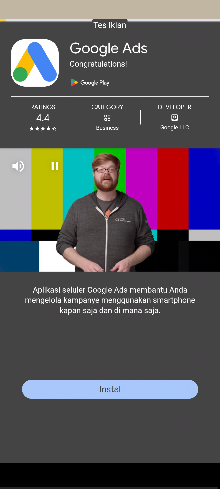

# Native Android verification — 1.4.1, 19 October 2026

The signed release APK was installed and tested on a physical Xiaomi 2201117TY running Android 13/API 33 at
1080 × 2400. All ad requests used Google's official sample units and the real `GoogleAdsClient`, with a separate
QA guild and preferences. These are native ads, not the desktop verification double.

## Completed checks

- Initialization: UMP allowed requests, the SDK initialized, and all three formats loaded. The first-party ID
  setting now runs after initialization and before the first ad request. Failed initialization releases its pending
  state for retry. Unity's web-request module is included for SDK diagnostics; the final report has no runtime error.
- Banner: the real adaptive banner displays below game navigation. The native Android navigation reserve is kept
  while system bars are hidden, with another 8 dp below the ad. The game reserves matching space above it.
- Android buttons: the screenshot shows all three system buttons unobstructed. On this phone the banner ends at
  y=2248, the navigation area starts at y=2270, and the screen ends at y=2400: a 22-pixel gap, equivalent to 8 dp.
  The actual Home button left the game; returning restored the banner, wallet, audio state and loaded inventory.
- Interstitial: a native test ad opened and was closed. The SDK recorded one presentation and the QA runner one
  completed close. The game resumed with its banner restored, audio unpaused and wallet unchanged.
- Rewarded cancellation: pressing Back two seconds after starting the native video dismissed it. No earned callback
  arrived; the wallet remained 600 gold / 10 gems and the game/audio resumed.
- Rewarded completion: the video reached the SDK's reward-granted state. Closing returned to the game and credited
  exactly 150 gold + 2 gems, reaching 750 / 12, matching the expected balances. Audio was restored.
- Save isolation: hashes of the player's original `emberhall.json` and backup were identical before and after the
  native test. No original save was cleared or replaced.
- Regression: 93 EditMode cases, 92 passed, zero failed, one explicit long pacing simulation skipped. The 1.4.0
  [desktop UI baseline](../1.4.0/README.md) remains 347 successful flows / 100 screenshots / zero layout issues;
  it was not rerun for this native-only correction. Native screenshots verify the changed banner placement.
- APK: version 1.4.1 / Android code 9, signed v2, ARM64, API 26 minimum / 36 target, official Google bridge classes,
  sample IDs and the navigation helper were inspected. See [package inspection](apk-check.json) for the digest.

## Evidence

[Device-check summary](phone-check.json) · [Banner geometry](banner-navigation.json) ·
[Early dismissal](reward-dismissed.json) · [Earned reward](reward-earned.json) ·
[Interstitial return](interstitial-closed.json) · [Home/return](home-return.json) ·
[Resumed game](resumed.json) · [Core tests](core-tests.xml)

This verifies the connected phone and current network, not every Android device or network condition. Production
inventory, publisher UMP regional forms, airplane-mode recovery and iOS still require their applicable device/account
checks. Natural-break frequency limits, failed/duplicate callbacks and reward caps also have existing core/desktop
coverage; the physical interstitial used the explicit test preview. Sample ads generate no revenue.
