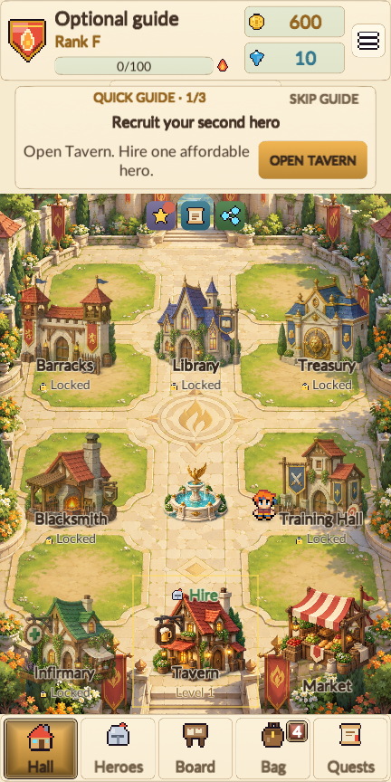
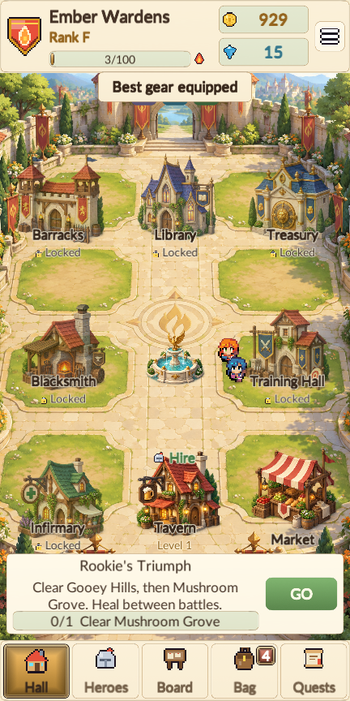
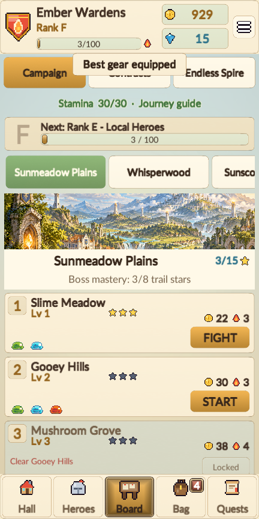
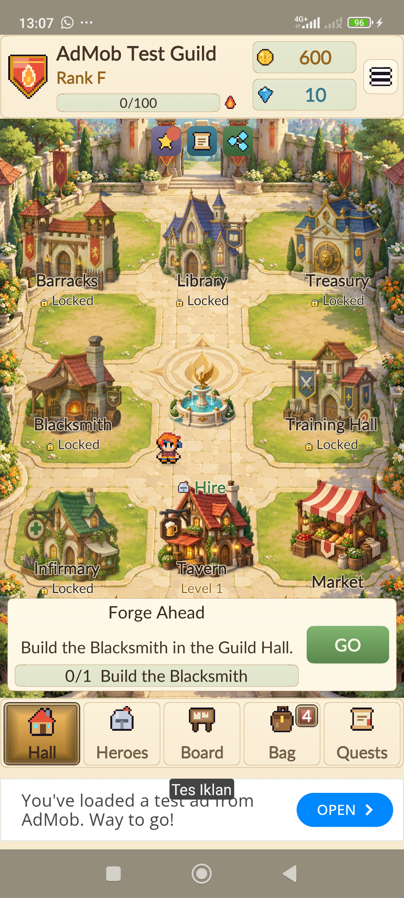

# Guide and native navigation verification — 1.4.2

The signed release APK was installed and checked on the connected Xiaomi 2201117TY, Android 13/API 33,
1080 × 2400, using three-button navigation. The native checks used Google's real SDK and official sample IDs
with a separate QA guild and preference prefix. The original guild and its backup were unchanged afterward.

## Short guide

- The real opening flow recruits a companion, wins Slime Meadow and equips the party through actual UI controls.
  After claiming the third reward, chapter four uses ordinary quests with no guide overlay, arrow or reserved strip.
- An older-guild fixture at the 100-Fame objective has no automatic pointer. Long-term rank and facility goals
  remain available through the normal quest navigation.
- SKIP GUIDE works on a fresh guild. It removes guidance without changing gold, gems, hero count or quest progress,
  and does not bypass the four-story-quest advertising grace period. The choice survives a real save reload.
- Starting another guild restores the guide. Settings can re-enable it while the opening quests are unfinished.
  Both English and Indonesian layouts were checked; the Treasury's income unit now sits beside its label so its
  amount remains readable as the guild grows.
- Desktop verification completed 354 successful flow checks and 105 screenshots, checking 3,717 texts with zero
  layout issues. Core tests: 92 passed, zero failed; one explicit long pacing simulation skipped.

## Android ads

- Banner protection now belongs to an app-owned native parent. The SDK can replace its child's LayoutParams on
  Show or resize without replacing the parent's navigation reserve. A pre-draw guard hides intermediate unsafe
  geometry. Bottom-bar changes update placement without unnecessarily replacing a same-width creative.
- The physical run completed 80 transitions through Hall, Bag and a supplies popup, repeatedly hiding/showing the
  real ad and replacing its child layout as the SDK does. It recorded 823 visible native pre-draw checks and zero
  unsafe draws. The protected host stayed in place. Android navigation was revealed repeatedly during this run.
- The banner ends at y=2248; the navigation area starts at y=2270 on a 2400-pixel screen. The remaining gap is
  22 pixels, or 8 dp. The screenshot shows all three system buttons clear.
- Tapping native Home exited the game; returning restored it. Tapping native Recent opened the task switcher,
  and native Back returned to the game. No navigation setting was changed.
- A native interstitial opened and closed, with one SDK presentation and one completed close. The banner returned,
  audio resumed and the wallet stayed at 600 gold / 10 gems.
- Dismissing a rewarded video after two seconds granted no reward and restored audio. A second video reached
  the SDK's reward-granted state; closing it credited exactly 150 gold and 2 gems, reaching 750 / 12. Returning to
  Hall restored the banner with zero unsafe draws or runtime errors.
- The QA mode was exited and the phone returned to the normal title. SHA-256 fingerprints of both original save
  files matched the fingerprints taken before testing. The APK is version 1.4.2 / Android code 10, signed v2,
  ARM64, API 26 minimum / 36 target; SDK classes, safe-host classes and sample IDs passed package inspection.

[Phone summary](phone-check.json) · [Banner geometry](banner-navigation.json) · [Repeated transitions](stress-complete.json) ·
[Home return](home-return.json) · [Recent and Back](recents-return.json) · [Interstitial return](interstitial-closed.json) ·
[Reward cancellation](reward-dismissed.json) · [Earned reward](reward-earned.json) · [Resumed Hall](resumed.json) ·
[Package inspection](apk-check.json) · [UI flow and layout audit](layout-audit.json) · [Core tests](core-tests.xml)

This run verifies the connected phone and current network. Other devices and gesture navigation, publisher UMP
regional forms, production inventory and iOS still require their applicable checks. Google sample ads generate
no revenue. The previous [1.4.1 native check](../1.4.1/README.md) retains additional full-screen ad screenshots.
